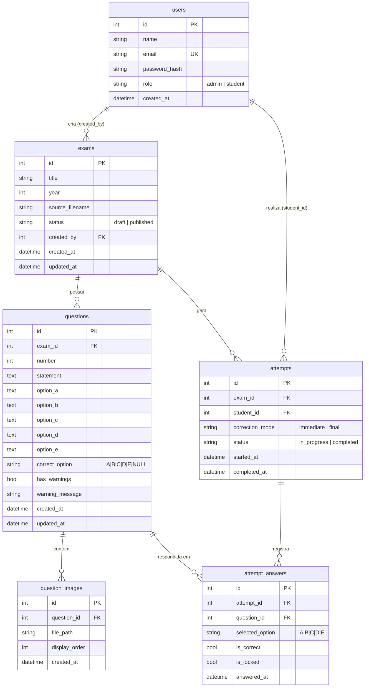

# Low-Level Design (LLD) — Sistema Questões ENADE (`esimenade`)

## 1. Escopo e Decisões de Arquitetura

### 1.1 Escopo do MVP (`PB01` a `PB09`)
- **Autenticação e Controle de Acesso (`PB01`, `PB02`)**: login básico com e-mail e senha para dois perfis pré-cadastrados via seed (**Administrador/Professor** e **Aluno**), com controle de acesso por perfil (RBAC).
- **Upload e Extração de Provas (`PB03`, `PB04`)**: upload de arquivo PDF de provas do ENADE com validação de camada de texto selecionável (rejeição de PDFs escaneados), extração automática de enunciados, alternativas (`A`–`E`) e imagens embutidas em `< 5s` para provas de até 40 questões, com acurácia `>= 95%` nas questões puramente textuais.
- **Conferência e Homologação (`PB05`)**: visualização e edição de enunciados/alternativas extraídas, remoção de questões ou imagens indevidas, cadastro de gabarito oficial e liberação da prova apenas quando **100%** das questões possuírem gabarito cadastrado.
- **Simulados do Aluno (`PB06`, `PB07`)**: listagem apenas de provas liberadas (edição/ano), resolução com alternância entre navegação **sequencial** (uma a uma) e **em bloco** (várias na tela), com tempo de resposta `< 1s`.
- **Modos de Correção (`PB08`, `PB09`)**: escolha prévia antes de iniciar a prova entre:
  - **Correção Imediata**: ao confirmar uma questão, a resposta é salva imediatamente na API, fica **travada** (não pode mais ser alterada) e exibe feedback instantâneo (correta/incorreta + gabarito).
  - **Correção ao Final**: cada escolha é salva na API permitindo alteração livre até a submissão final; ao concluir, exibe relatório consolidado com total de acertos, erros e percentual de aproveitamento.

### 1.2 Fora de Escopo (Explicitamente Descartado)
- `PB10`, `PB11`, `PB12`, `PB13`, `PB14` (histórico de simulados, painéis analíticos do professor e métricas agregadas).
- Login com Google OAuth e tela de auto-cadastro de usuários.
- Filtro de questões por tema (presente na EAP, fora dos `PB06`–`PB09`).
- Adição manual de novas questões pelo administrador (permitido apenas editar ou remover questões extraídas, além de excluir/despublicar provas).

---

## 2. Stack Tecnológico e Estrutura do Repositório

- **Back-end**: Python 3.11+, FastAPI, SQLAlchemy 2.x, Pydantic v2, PyMuPDF (`pymupdf`), `uvicorn`, `pytest`.
- **Banco de Dados**: SQLite (arquivo local `backend/storage/esimenade.db`).
- **Front-end**: React + TypeScript (Vite), Tailwind CSS, React Router, Axios/Fetch wrapper.
- **Execução**: 100% local.

```text
esimenade/
├── docs/
│   ├── Equipe 1 - Backlog.pdf
│   ├── tech_stack_e_detalhes.md
│   ├── LLD.md
│   └── exemplo_provas/              # PDFs reais do ENADE para validação/testes
├── backend/
│   ├── app/
│   │   ├── main.py                  # Entrypoint FastAPI, CORS, StaticFiles (/media), lifespan seed
│   │   ├── core/
│   │   │   ├── config.py            # Configurações (.env, caminhos, JWT secret, credenciais seed)
│   │   │   ├── database.py          # Engine SQLite, SessionLocal, Base, get_db
│   │   │   └── security.py          # Hash de senha (pbkdf2_sha256) e geração/validação de JWT
│   │   ├── models/
│   │   │   ├── user.py
│   │   │   ├── exam.py
│   │   │   ├── question.py
│   │   │   └── attempt.py
│   │   ├── schemas/
│   │   │   ├── auth.py
│   │   │   ├── exam.py
│   │   │   ├── question.py
│   │   │   └── attempt.py
│   │   ├── services/
│   │   │   ├── pdf_extractor.py     # Validação de texto, segmentação de questões e extração de imagens
│   │   │   ├── exam_service.py      # Regras de publicação (100% gabarito), edição e limpeza de arquivos
│   │   │   └── attempt_service.py   # Regras de correção imediata (travamento) e correção ao final
│   │   └── routers/
│   │       ├── auth.py
│   │       ├── admin_exams.py
│   │       ├── admin_questions.py
│   │       └── student_exams.py
│   ├── tests/
│   │   ├── test_pdf_extractor.py    # Testes automatizados com os PDFs de docs/exemplo_provas/
│   │   ├── test_auth.py
│   │   ├── test_admin_flow.py
│   │   └── test_student_flow.py
│   ├── storage/                     # Ignorado no Git (SQLite + imagens extraídas)
│   │   └── images/
│   └── requirements.txt
├── frontend/
│   ├── src/
│   │   ├── api/                     # Cliente HTTP + módulos (auth, adminExams, studentExams)
│   │   ├── contexts/                # AuthContext (usuário logado + token)
│   │   ├── components/              # Layout, ProtectedRoute, QuestionCard, QuestionNav, etc.
│   │   ├── pages/
│   │   │   ├── LoginPage.tsx
│   │   │   ├── admin/
│   │   │   │   ├── AdminExamsPage.tsx
│   │   │   │   └── AdminExamReviewPage.tsx
│   │   │   └── student/
│   │   │       ├── StudentExamsPage.tsx
│   │   │       ├── ExamAttemptPage.tsx
│   │   │       └── AttemptResultPage.tsx
│   │   ├── types/
│   │   ├── App.tsx
│   │   └── main.tsx
│   ├── package.json
│   └── vite.config.ts
├── .gitignore
└── README.md
```

---

## 3. Modelagem de Dados (SQLite)

> `PRAGMA foreign_keys = ON` será ativado em toda conexão SQLite para garantir `ON DELETE CASCADE`.



### Regras de Integridade e Seed
- `attempt_answers`: restrição `UNIQUE(attempt_id, question_id)`.
- `questions`: índice em `(exam_id, number)`.
- **Seed automático no startup** (idempotente — só cria se não existir):
  - **Administrador**: `admin@esimenade.com` / `admin123` (`role = 'admin'`)
  - **Aluno**: `aluno@esimenade.com` / `aluno123` (`role = 'student'`)

---

## 4. Arquitetura do Extrator de PDF (`pdf_extractor.py`)

A análise preliminar dos 3 PDFs reais em `docs/exemplo_provas/` (`2023_PV_engenharia_da_computacao.pdf`, `2023_PV_nutricao.pdf` e `ENGENHARIA_COMPUTACAO.pdf`) revelou padrões importantes que guiam o design:
- Variação de caixa nos cabeçalhos devido a fontes *Small Caps* (ex.: `QUESTÃO 02`, `QuEStão 02`, `QuEStão diSCurSiva 02`).
- Fontes CFF/Type1 com ligaduras que degradam em `pypdf`, mas são extraídas com precisão e alta velocidade via **PyMuPDF (`fitz`)**.
- Presença de cabeçalhos/rodapés repetitivos (ex.: `LOGO`, `MATÉRIA`, nome do curso, número da página), questões discursivas no início da prova e *Questionário de Percepção da Prova* no final.
- Imagens embutidas dentro do fluxo de enunciados e alternativas.

### Pipeline em 5 Estágios
1. **Validação do Arquivo (`PB03`)**:
   - Verifica extensão `.pdf` e assinatura mágica `%PDF-`.
   - Abre com `fitz.open(stream=...)` e contabiliza caracteres extraíveis nas páginas.
   - Se o documento estiver vazio ou possuir média insignificante de texto selecionável (ex.: `< 50` caracteres úteis no total ou `< 10%` das páginas com texto), rejeita com `HTTP 422` informando que o PDF parece escaneado/sem camada de texto.
2. **Normalização e Remoção de Ruído**:
   - Extrai blocos de texto com coordenadas `(x0, y0, x1, y1)` via `page.get_text("blocks")`.
   - Descarta blocos na zona de cabeçalho/rodapé extremo e ruídos conhecidos (`ÁREA LIVRE`, `RASCUNHO`, `LOGO`, `MATÉRIA`).
   - Ordena os blocos respeitando a ordem de leitura da página (incluindo detecção de layout em 2 colunas quando presente).
3. **Segmentação de Questões (`PB04`)**:
   - Identifica cabeçalhos de questão com regex case-insensitive:
     - `^\s*QUEST[ÃA]O\s+DISCURSIVA\s+\d+` → **ignorada** (fora do escopo de objetivas A–E).
     - `^\s*QUEST[ÃA]O\s+(\d+)\b` → inicia nova questão objetiva.
   - Encerra a captura ao encontrar `QUESTION[ÁA]RIO\s+DE\s+PERCEP[ÇC][ÃA]O`.
   - Registra para cada questão seu intervalo espacial `(page_index, y_start)` até o início da próxima questão.
4. **Segmentação Enunciado vs. Alternativas (`A`–`E`)**:
   - Localiza marcadores de alternativa no início de linha (`A`, `B`, `C`, `D`, `E` seguidos de espaço, ponto ou parêntese, em ordem crescente `A -> B -> C -> D -> E`).
   - Tudo antes de `A` compõe o `statement`; cada trecho seguinte compõe `option_a` .. `option_e`.
   - Se alguma alternativa `A`–`E` não for identificada com segurança, a questão ainda é salva para conferência do admin com `has_warnings = True` e `warning_message` descritiva.
5. **Extração e Associação de Imagens**:
   - Para cada página, consulta `page.get_images(full=True)` e suas posições via `page.get_image_rects(xref)`.
   - **Filtragem de ruído**: descarta imagens pequenas (`width < 60px` ou `height < 60px`) e imagens cujo `xref`/hash apareça repetido em `>= 3` páginas (logos institucionais/cabeçalhos).
   - **Associação**: vincula cada imagem à questão cujo intervalo `(page_index, y_start..y_end)` contém o centro vertical da imagem.
   - Salva os arquivos em `backend/storage/images/{exam_id}/q{number}_{order}.png` e registra em `question_images`.

### Meta de Desempenho (`PB04`)
- Com PyMuPDF operando em C, a extração completa (texto + imagens) de um PDF de 40 questões deve levar entre **0.3s e 1.5s**, com margem folgada abaixo do limite de **5s**.

---

## 5. Contrato da API REST (FastAPI)

Base URL local: `http://localhost:8000/api`  
Imagens estáticas: `http://localhost:8000/media/images/{exam_id}/{filename}`

### 5.1 Autenticação (`PB01`, `PB02`)
| Método | Rota | Acesso | Descrição |
|---|---|---|---|
| `POST` | `/auth/login` | Público | Recebe `{ email, password }`; retorna `{ access_token, token_type, user: { id, name, email, role } }`. Retorna `401` em credenciais inválidas. |
| `GET` | `/auth/me` | Autenticado | Retorna os dados do usuário logado. |

### 5.2 Administração — Provas e Questões (`PB03`, `PB04`, `PB05`)
> Todas as rotas `/admin/*` exigem `role == 'admin'` (caso contrário retornam `403 Forbidden`).

| Método | Rota | Descrição |
|---|---|---|
| `GET` | `/admin/exams` | Lista todas as provas (`draft` e `published`) com contagem de questões, quantas já têm gabarito e quantas possuem avisos. |
| `POST` | `/admin/exams/upload` | `multipart/form-data` com `file` (PDF), `title` (string) e `year` (int). Valida PDF, extrai questões e imagens, cria prova em `draft` e retorna resumo da extração (incluindo `extraction_time_ms` e `warnings_count`). |
| `GET` | `/admin/exams/{exam_id}` | Retorna detalhes da prova + todas as questões (incluindo `correct_option`, `has_warnings` e `images[]`). |
| `PATCH` | `/admin/exams/{exam_id}` | Atualiza metadados (`title`, `year`). |
| `POST` | `/admin/exams/{exam_id}/publish` | Valida que existe `>= 1` questão e **100%** possuem `correct_option` definido e alternativas `A`–`E` preenchidas. Muda `status` para `published` (ou retorna `422` listando os números das questões pendentes). |
| `POST` | `/admin/exams/{exam_id}/unpublish` | Retorna a prova para `draft`. |
| `DELETE` | `/admin/exams/{exam_id}` | Remove a prova, questões, tentativas (cascade) e apaga a pasta de imagens no disco. |
| `PATCH` | `/admin/questions/{question_id}` | Edita `statement`, `option_a`..`option_e` e/ou `correct_option`. Reavalia `has_warnings`. |
| `DELETE` | `/admin/questions/{question_id}` | Remove uma questão extraída e suas imagens. (Se a prova estava `published` e ficar sem questões, volta para `draft`). |
| `DELETE` | `/admin/questions/{question_id}/images/{image_id}` | Remove uma imagem específica associada à questão (banco + disco). |

### 5.3 Aluno — Simulados e Correção (`PB06`, `PB07`, `PB08`, `PB09`)
> Rotas protegidas por autenticação (`student` ou `admin` para teste; alunos nunca recebem `correct_option` antes da correção).

| Método | Rota | Descrição |
|---|---|---|
| `GET` | `/exams` | Lista apenas provas com `status == 'published'` (`id`, `title`, `year`, `question_count`). |
| `POST` | `/exams/{exam_id}/attempts` | Inicia um simulado. Body: `{ correction_mode: "immediate" | "final" }`. Retorna `{ attempt_id, exam, correction_mode, questions[] }` (**sem** `correct_option`). |
| `GET` | `/attempts/{attempt_id}` | Retorna estado atual da tentativa (questões + respostas já salvas). No modo `immediate`, inclui `is_correct` e `correct_option` apenas para questões já respondidas/travadas. |
| `POST` | `/attempts/{attempt_id}/answers` | Salva imediatamente a resposta de uma questão. Body: `{ question_id, selected_option }`.<br>- **Modo `immediate`**: calcula `is_correct`, salva com `is_locked = True` e retorna `{ question_id, selected_option, is_locked: true, is_correct, correct_option }`. Se a questão já estiver travada, retorna `409 Conflict`.<br>- **Modo `final`**: faz upsert com `is_locked = False` (permite alterar antes de finalizar) e retorna `{ question_id, selected_option, is_locked: false }` (sem vazar gabarito). |
| `POST` | `/attempts/{attempt_id}/finish` | Finaliza a tentativa (`status = 'completed'`), trava todas as respostas e retorna o relatório consolidado: `{ total_questions, answered_count, correct_count, wrong_count, unanswered_count, accuracy_percent, details: [{ question_id, number, selected_option, correct_option, is_correct }] }`. |

---

## 6. Arquitetura do Front-end (React + TypeScript + Tailwind — Material Design 3)

### Diretrizes Visuais (Material Design 3 — Branco e Azul)
- **Paleta principal**:
  - **Surface / Background**: branco (`#FFFFFF`) e superfície tonal clara (`#F8FAFD` / `#F0F4F9`).
  - **Primary (Azul MD3)**: `#0B57D0` (hover `#0842A0`), **On Primary**: `#FFFFFF`.
  - **Primary Container**: `#D3E3FD` / `#E8F0FE`, **On Primary Container**: `#041E49`.
  - **Outline / Borders**: `#C4C7C5` e `#747775` (foco em `#0B57D0`).
  - **Error Container**: `#FCE8E6` com texto `#B3261E`.
- **Componentes MD3**: cards com cantos arredondados (`rounded-3xl` / `rounded-2xl`), elevação suave, botões *Filled* em pílula (`rounded-full`), campos *Outlined* com foco em azul primário e tipografia limpa (`Roboto` / `Inter`).

### Fluxo de Telas
1. **Login Único (`/login`)**: tela única de autenticação para Administrador e Aluno com e-mail e senha; redireciona `admin` para `/admin` e `student` para `/exams`. Exibe banner de erro MD3 em caso de credenciais inválidas.
2. **Painel de Provas do Admin (`/admin`)**:
   - Card/modal de upload de PDF com campos `Título`, `Ano` e seletor de arquivo `.pdf` (Sprint 2+).
   - Tabela/cards de provas com badge de status (`Rascunho` / `Liberada`), progresso de gabarito (`32/35`) e ações (`Revisar`, `Despublicar`, `Excluir`).
3. **Conferência e Gabarito (`/admin/exams/:id/review`)**:
   - Barra fixa no topo com progresso de gabarito (`X de N questões homologadas`), filtro rápido ("Todas" / "Sem gabarito" / "Com aviso") e botão **"Liberar Prova"** (habilitado somente em 100%).
   - Para cada questão: edição inline de enunciado e alternativas `A`–`E`, galeria de imagens extraídas com botão de remover imagem, seletor da alternativa correta (`A`–`E`) com salvamento imediato e botão de excluir questão.
4. **Lista de Simulados do Aluno (`/exams`)**:
   - Cards das provas liberadas (`Título`, `Ano`, `Nº de questões`).
   - Ao clicar em **"Iniciar Simulado"**, modal permite escolher o modo de correção (**Correção Imediata** ou **Correção ao Final**).
5. **Resolução do Simulado (`/exams/:examId/attempt/:attemptId`)**:
   - Cabeçalho com alternador de visualização: **Sequencial (1 por vez)** vs. **Em Bloco (todas na tela)** (`PB07`).
   - Mapa de navegação numerado (`1..N`) indicando questões respondidas, e no modo imediato, verde (acerto) ou vermelho (erro).
   - **Modo Imediato**: aluno seleciona uma alternativa e clica em **"Confirmar Resposta"** → salva via API, trava os rádios daquela questão e exibe banner imediato de acerto/erro com o gabarito.
   - **Modo Final**: ao clicar em uma alternativa, salva imediatamente via API (mantendo editável); botão **"Finalizar e Corrigir Prova"** envia o encerramento e leva ao relatório.
6. **Relatório Consolidado (`/attempts/:attemptId/result`)**:
   - Cards de resumo: Total de Acertos, Total de Erros, Em Branco e Percentual de Aproveitamento.
   - Lista revisável das questões mostrando a alternativa marcada vs. gabarito oficial.

---

## 7. Plano de Implementação por Sprints

> O desenvolvimento segue entregas incrementais definidas pelos Product Owners a cada sprint.

- **Sprint 1 (Atual) — Autenticação e Controle de Acesso (`PB01`, `PB02`)**:
  - Tela de login única alinhada ao Material Design 3 (branco e azul).
  - Autenticação de Administrador (`PB01`) com seed pré-cadastrado, JWT, proteção de rotas administrativas (RBAC) e redirecionamento para `/admin`.
  - Autenticação de Aluno (`PB02`) com seed pré-cadastrado, acesso restrito ao perfil de aluno (bloqueio de rotas administrativas) e redirecionamento para `/exams`.
  - Tratamento de credenciais inválidas e cobertura com testes automatizados (`pytest`).
- **Sprints Futuras (conforme priorização dos POs)**:
  - Upload de PDF com validação de camada de texto (`PB03`) e extração automática de enunciados, alternativas e imagens (`PB04`), validada contra os PDFs de `docs/exemplo_provas/`.
  - Conferência, edição, remoção e homologação de 100% do gabarito (`PB05`).
  - Listagem de simulados liberados (`PB06`), resolução sequencial/em bloco (`PB07`) e modos de correção imediata/ao final (`PB08`, `PB09`).
